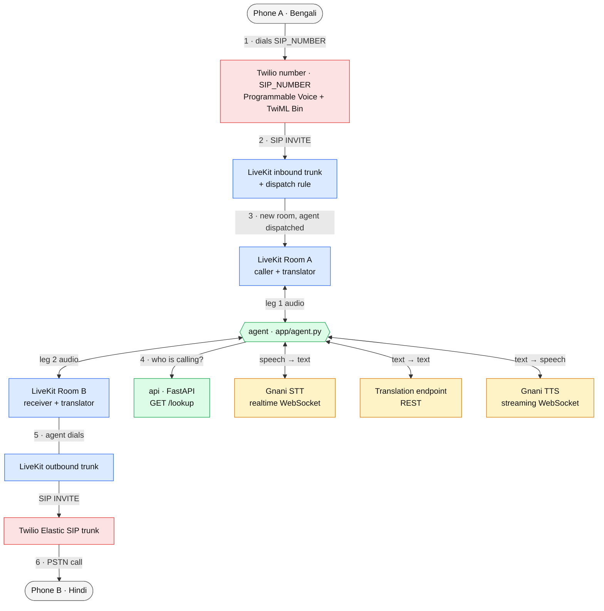
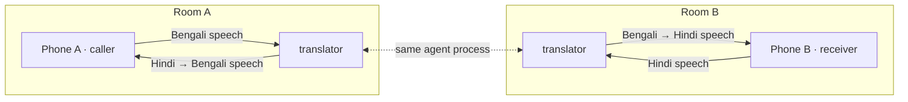
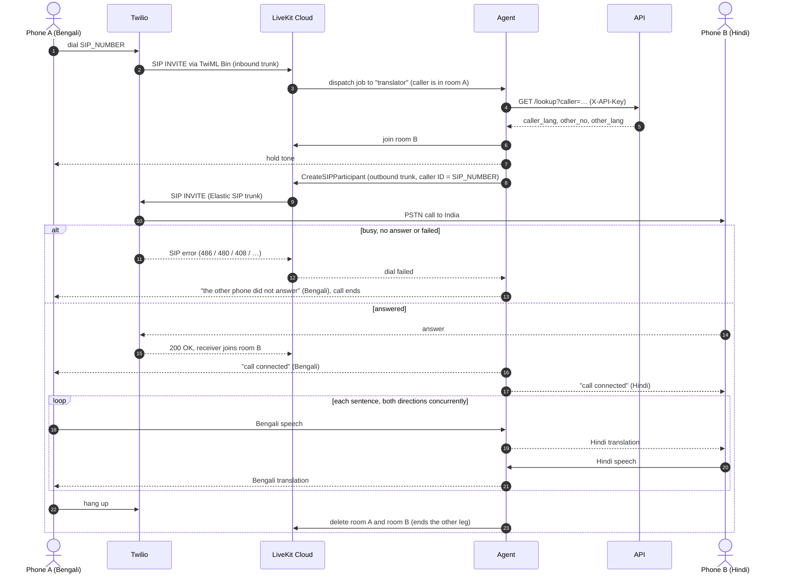
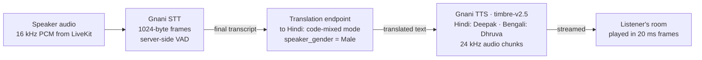

# Polyglot: real-time translated phone calls

Two people who don't share a language talk on ordinary mobile phones. Each sentence is transcribed, translated and spoken to the other person in their own language, live, both ways at once.

The current demo connects one fixed pair of phones:

| Party | Phone | Language | Hears translations in the voice |
|---|---|---|---|
| A | `+9191xxx` | Bengali (`bn-IN`) | Dhruva (male) |
| B | `+9163xxx` | Hindi (`hi-IN`) | Deepak (male) |

Either phone starts a call by dialling the project's Twilio number (`SIP_NUMBER`). The server then rings the other phone. Dialling the other mobile directly is just a normal, untranslated call.

> Original architecture sketches (masked calling, SIP flow, number pools, translation): [Excalidraw board](https://excalidraw.com/#json=i_GVFj5tfB-mz0OrsOrJB,y8f-48RESD_8jrDzrArfjg)

---

## Why: the vision

Delivery and ride-hailing apps (Zomato, Swiggy, Uber) already put a server in the middle of rider ↔ customer calls. Both phones dial a **virtual number** and an Indian CPaaS (Exotel, Plivo, Knowlarity) bridges two separate phone legs, so neither side sees the other's real number. Calls are routed by *(caller number, dialled virtual number) → active lease → other party*.

That server in the middle is also the right place to add **translation**. Instead of bridging the two legs' audio directly, it feeds each leg into a pipeline: *A → speech-to-text → translate → text-to-speech → B*, and the mirror image for replies. The Excalidraw board sketches the full version, with virtual-number pools, per-order leases and a Mumbai-hosted translation server.

**What this repo builds is the translation core of that idea**, with simplifications:

| In the vision | In this repo today |
|---|---|
| Pool of Indian virtual numbers, leased per order | One fixed Twilio US number, one fixed phone pair |
| Indian CPaaS (Exotel / Plivo) | Twilio (phone network) + LiveKit Cloud (SIP + media rooms) |
| Lease lookup by (caller, virtual number) | `GET /lookup` over the two configured phones |
| Translation server in Mumbai | Docker on a developer machine; LiveKit media pinned to India |
| Same-language calls bridged directly | Not implemented (every call is translated) |

---

## Architecture



<sub>🟥 Twilio · 🟦 LiveKit Cloud (India region) · 🟩 this repo, running in Docker · 🟨 AI vendors. Numbers follow the order of a call.</sub>

| Component | What it does | Code / config |
|---|---|---|
| **Twilio US number** | Receives the international call from either phone. A TwiML Bin forwards it to LiveKit over SIP. | `config/sip/twilio-inbound.example.xml` |
| **LiveKit inbound trunk** | Accepts that SIP call only with the right username/password, and only from the two configured phones. | `config/sip/inbound-trunk.example.json` |
| **LiveKit dispatch rule** | Puts each inbound call in a fresh room (`call-…`) and dispatches the `translator` agent to it. | `config/sip/dispatch-rule.example.json` |
| **agent** | Runs the call: identifies the caller, dials the other phone, streams audio through STT → translate → TTS in both directions, handles interruptions, failures and cleanup. | `app/agent.py` |
| **api** | A tiny authenticated phonebook: given the caller's number, returns the other phone and both languages. | `app/api.py`, `app/routing.py` |
| **LiveKit outbound trunk** | Places the call to the other phone through Twilio's Elastic SIP trunk, showing `SIP_NUMBER` as caller ID. | `config/sip/outbound-trunk.example.json` |
| **Vendors** | Gnani: live speech-to-text and streamed text-to-speech. Translation endpoint: text translation. | `app/vendors.py` |

### Inbound vs outbound trunk

A translated call is really **two independent phone calls**, one per person, and each needs its own trunk:

- **Inbound (leg 1, caller → LiveKit).** Phone A calls the Twilio number. Twilio runs the TwiML Bin, which contains a `<Dial><Sip>` to `sip:<SIP_NUMBER>@<subdomain>.india.sip.livekit.cloud`. LiveKit's inbound trunk authenticates it and checks the caller is on the allow-list. This leg uses Programmable Voice + TwiML rather than Twilio's Elastic SIP *origination*, because origination can't do username/password auth.
- **Outbound (leg 2, LiveKit → receiver).** The agent calls LiveKit's `CreateSIPParticipant` with the outbound trunk, the receiver's number and `SIP_NUMBER` as caller ID. LiveKit sends the INVITE to Twilio's Elastic SIP trunk *termination* domain, and Twilio places the PSTN call to India. The Twilio number is deliberately **not** attached to Elastic SIP origination, which would bypass the TwiML inbound route.

### Why two rooms instead of one



The two phones are never in the same room, so neither can hear the other's original voice, not even through a subscription mistake or SIP early media (ringback before answer). The agent is the only participant in both rooms, and it only ever publishes **translated** speech. This mirrors the "NO bridge" box in the sketch: the CPaaS never connects the two legs' audio directly.

---

## A call, step by step



An unknown caller (not one of the two configured phones) gets no outgoing call; the room is closed straight away.

---

## The translation pipeline

Each direction runs independently and processes one sentence at a time:



- **Speech-to-text.** One Gnani WebSocket per phone. Gnani's server-side voice detection decides where a sentence ends. It sends `speech_start` when someone starts talking and a final `transcript` when they stop. (`speech_start` isn't in Gnani's published docs but is sent by the live server.)
- **Translation.** A REST translation endpoint, one request per sentence. Translation into Hindi uses a code-mixed mode, so English words people commonly use stay natural. Both targets request male-gendered phrasing to match the male voices.
- **Text-to-speech.** Gnani streams audio back in chunks, and playback starts on the first chunk instead of waiting for the whole sentence. Each phone keeps **one TTS WebSocket open for the whole call**. That cuts time-to-first-audio from about 500 ms to about 250 ms on later sentences. The socket is replaced after 20 s of idle time (Gnani silently drops idle sockets), or after an interrupted sentence (leftover audio would otherwise leak into the next one).
- **Interruptions (barge-in).** If the listener starts talking while translated speech is playing to them, playback stops immediately and pending sentences are dropped.
- **Slow vendors.** Translation and time-to-first-audio each get 3 s. On a first timeout the listener hears "please wait" in their language and the step is retried once; a second timeout skips that sentence. Original speech is never played as a fallback.

---

## Repository layout

```
app/
  agent.py      LiveKit worker: call lifecycle, two rooms, dialing, audio legs, barge-in, cleanup
  api.py        FastAPI: /healthz and authenticated /lookup
  routing.py    caller → (other phone, languages) for the configured pair
  pipeline.py   runs both translation directions concurrently
  vendors.py    Gnani STT/TTS and translation-endpoint clients, plus offline "fake" vendors
config/sip/     templates for the LiveKit inbound/outbound trunks, dispatch rule and Twilio TwiML Bin
tests/          unit tests (test_bengali.py) and a LiveKit end-to-end test (see Testing)
docs/           design notes, implementation plan, project overview
SETUP.md        detailed (Windows-oriented) setup and provisioning log
```

---

## Configuration

Copy `.env.example` to `.env` and fill it in. Never commit `.env`.

| Variable | Purpose |
|---|---|
| `API_KEY` | Shared secret between agent and API (any long random string) |
| `API_URL` | Where the agent reaches the API (`http://api:8000` inside Docker) |
| `PARTY_A_NO`, `PARTY_A_LANG` | First phone and its language (`+9191xxx`, `bn-IN`) |
| `PARTY_B_NO`, `PARTY_B_LANG` | Second phone and its language (`+9163xxx`, `hi-IN`) |
| `SIP_NUMBER` | The Twilio number both phones dial, also the outbound caller ID |
| `VENDORS` | Real vendors (Gnani + translation endpoint) or `fake` offline stand-ins; values in `.env.example` |
| Translation API key | Key for the translation endpoint (variable name in `.env.example`) |
| `GNANI_API_KEY` | Gnani, for speech-to-text and text-to-speech |
| `DIAL_MODE` | `sip` = real phone calls · `room` = simulated participants |
| `LIVEKIT_URL`, `LIVEKIT_API_KEY`, `LIVEKIT_API_SECRET` | LiveKit Cloud project |
| `LIVEKIT_SIP_OUTBOUND_TRUNK_ID` | LiveKit outbound trunk ID (`ST_…`, not Twilio's `TK…`) |

In `sip` mode the agent refuses to start unless every value is set, `LIVEKIT_URL` is a `wss://….livekit.cloud` URL, the dev keys aren't in use, and real vendors are selected.

One-time provisioning of the Twilio number, TwiML Bin, Elastic SIP trunk and the LiveKit trunks/dispatch rule is described in [SETUP.md §6](SETUP.md), using the templates in `config/sip/`.

---

## Running

```bash
uv sync --extra test                       # Python 3.12 env with dev deps

# check the live configuration
uv run --env-file .env python -c "from app.agent import validate_config; validate_config(); print('config OK')"

# start API + agent (code is bind-mounted; --build only needed after dependency changes)
docker compose up -d --build api agent
curl -s http://127.0.0.1:8000/healthz      # {"status":"ok"}
docker compose logs -f agent
```

Then dial `SIP_NUMBER` from one of the two configured phones. The agent connects outbound to LiveKit Cloud, so it needs no public URL or open ports.

### Reading the logs

| Log line | Meaning |
|---|---|
| `dial_started` / `receiver_sip_status status=ringing` / `dial_answered` | Progress of the call to the other phone |
| `dial_failed outcome=… sip_status=…` | Other phone was busy, didn't answer or failed (with the SIP code) |
| `caller_left` / `receiver_left reason=…` / `room_disconnected` | Who ended the call and why |
| `translation_failed`, `vendor_sentence_skipped`, `vendor_sentence_truncated` | A sentence was lost to a vendor error or timeout |
| `call_summary … p50_ms=… a_heard=… a_played=… b_heard=… b_played=…` | End of call: latency, plus per phone (`a` = caller, `b` = receiver) how many sentences were transcribed (`heard`) and how many translations they received (`played`) |

No phone numbers, transcripts or credentials are logged beyond the room-based call ID.

---

## Testing

```bash
uv run --extra test pytest tests/test_bengali.py    # offline: routing, prompts, translation + voice parameters
```

`tests/test_e2e_livekit.py` drives a full call through a **local** LiveKit server with fake vendors. That local server was removed from `docker-compose.yml` in favour of LiveKit Cloud, so this test currently fails if run as-is.

---

## Status and known limitations

- **Demo scope.** One fixed phone pair, no virtual-number pool, leases or orders, and no same-language direct bridge.
- **Languages.** Gnani supports 10 Indian languages, but **not Odia**, which is why the demo moved from Odia ↔ Hindi to Bengali ↔ Hindi. The routing and translation code accept other supported pairs.
- **Real-phone validation is incomplete.** Accuracy on noisy phone audio hasn't been measured for Bengali yet.
- **Carrier reachability.** In testing, Jio sometimes returned `480 Temporarily Unavailable` for the outbound leg without the phone ringing. This is on the carrier/handset side; the caller hears a "did not answer" message.
- **Undocumented vendor behaviour.** Gnani STT's `speech_start` event and Gnani TTS's idle-socket timeout (20–45 s) were found by live testing and aren't documented by Gnani, so they could change without notice.
- **Hosting.** API and agent run in Docker on a developer machine; a hosted Mumbai deployment is deferred.
